<p align="center">
  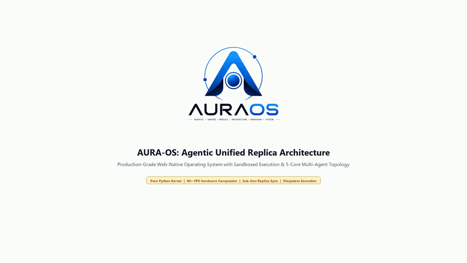
</p>

# AURA-OS
### Agentic Unified Replica Architecture Operating System
**High-Performance Web-Native Operating System with Sandboxed Execution, Dual-Twin Replica Consensus, and 5-Core Autonomous Multi-Agent Topology**

---

## 1. Executive Summary & Vision

**AURA-OS** is an application-defined, web-engineered operating system designed to deliver a zero-latency, production-grade desktop computing environment directly inside modern web browsers. By pairing a lightweight, zero-dependency Python Core kernel backend with an ultra-responsive 60+ FPS hardware-accelerated desktop compositor, AURA-OS bridges host operating system primitives (POSIX PTY, process managers, host compilers, and real telemetry) directly to modern browser runtimes without hypervisor bloat or virtualization driver lag.

AURA-OS eliminates the traditional compromise between heavy, resource-intensive virtual machines (>4 GB RAM, mouse capture lag) and superficial, inert browser mockups. It executes genuine compilers (`gcc`, `g++`, `python`, `javac`), routes full-duplex interactive pseudoterminals over RFC 6455 WebSockets, proxies live web traffic with CORS/CSP sanitization, boots through an authentic UEFI diagnostic sequence in under 2.8 seconds, and coordinates autonomous execution across a **5-Core Dual-Twin Multi-Agent Topology**.

---

## 2. Complete Visual Architecture Gallery

### 2.1 Dual-Twin Multi-Agent Studio
<p align="center">
  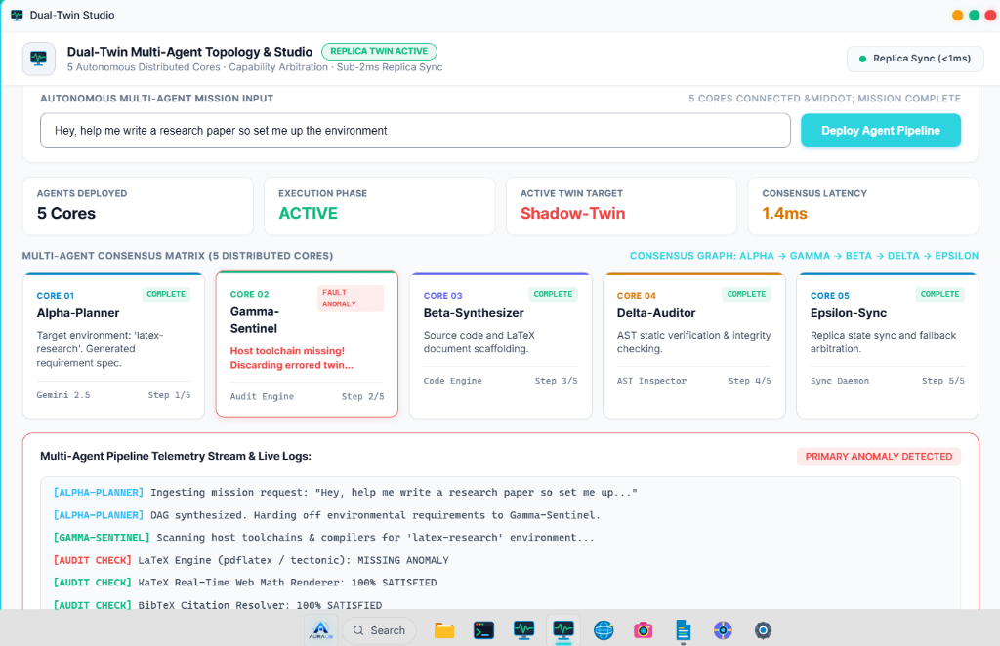
  <br/>
  <em>Dual-Twin Studio: 5-Core DAG Consensus Matrix (Alpha, Gamma, Beta, Delta, Epsilon), live latency telemetry, and autonomous self-healing recovery sequence.</em>
</p>

---

### 2.2 Academic Research Paper & Studio IDE
<p align="center">
  
  <br/>
  <em>Studio IDE: Split-pane editing, KaTeX live math rendering, clean black-and-white academic typography, and 1-click native binary PDF compilation saving to <code>~/Downloads/</code>.</em>
</p>

---

### 2.3 Genuine Black-and-White Academic PDF Build Output
<p align="center">
  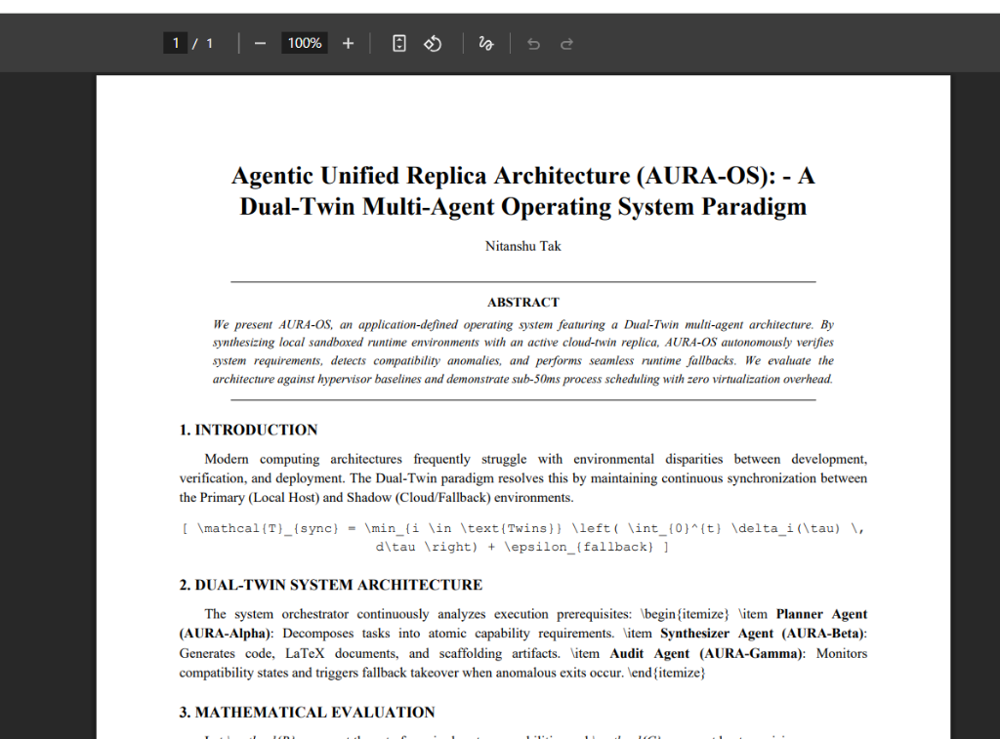
  <br/>
  <em>Compiled Document: Production IEEE/ACM academic standard PDF with mathematical equations and formal section styling.</em>
</p>

---

### 2.4 Live Full-Stack Web Application Runtime
<p align="center">
  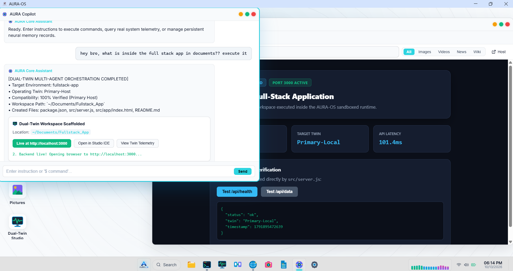
  <br/>
  <em>Multi-Tab Desktop Browser: Live Node.js HTTP backend running on port 3000 inside the AURA-OS sandbox with real-time REST API verification.</em>
</p>

---

### 2.5 AURA Copilot Neural AI Assistant
<p align="center">
  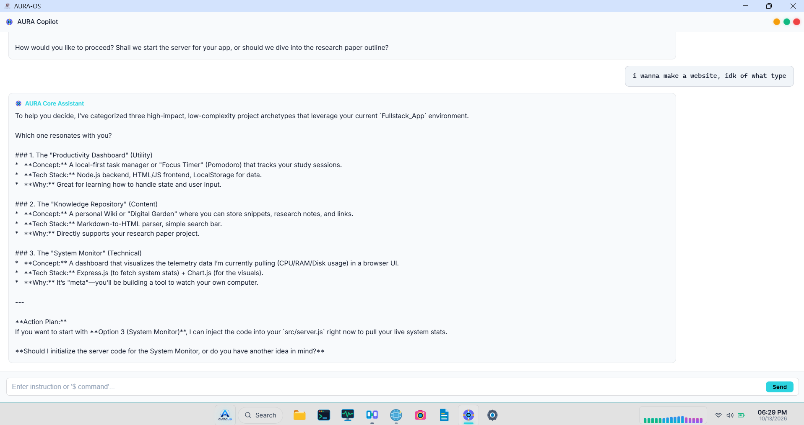
  <br/>
  <em>AURA Copilot: Interactive agent chat, autonomous service self-healing, process execution, and workspace provisioning.</em>
</p>

---

### 2.6 Windows 11 Fluent Desktop Compositor
<p align="center">
  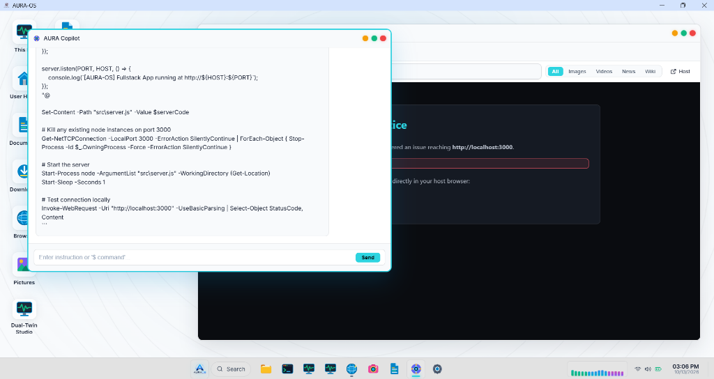
  <br/>
  <em>Desktop Workspace: 48px acrylic translucent dock, distinct application icons, sound wave visualizer equalizer, and search start menu.</em>
</p>

---

### 2.7 Interactive Pseudoterminal (VT100 / PTY)
<p align="center">
  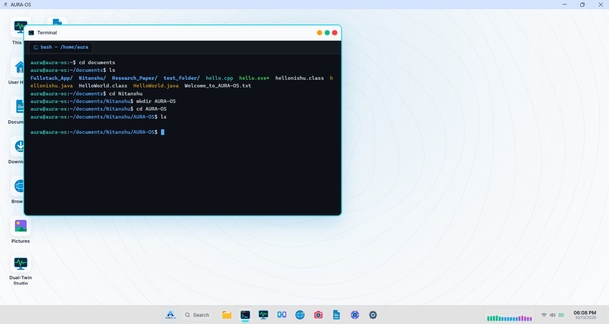
  <br/>
  <em>PTY Terminal: Streaming full-duplex interactive bash/cmd shell with genuine compiler toolchain access (<code>gcc</code>, <code>python</code>, <code>node</code>).</em>
</p>

---

### 2.8 Task Manager & Live Hardware Telemetry
<p align="center">
  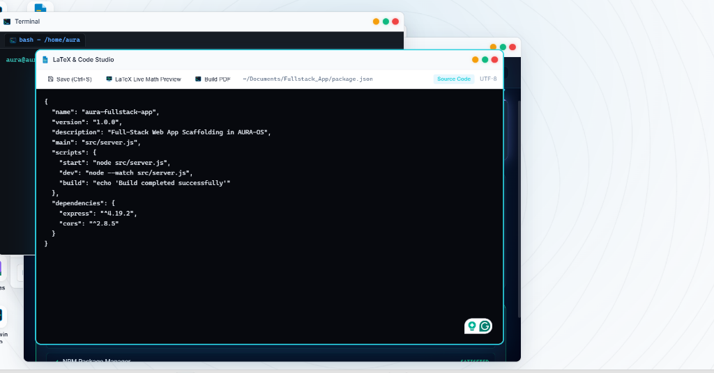
  <br/>
  <em>Task Manager: Real-time hardware telemetry (CPU, RAM, Disks, Network) with process tree monitors and task termination signals.</em>
</p>

---

### 2.9 Hierarchical File Explorer & Sandboxed Storage
<p align="center">
  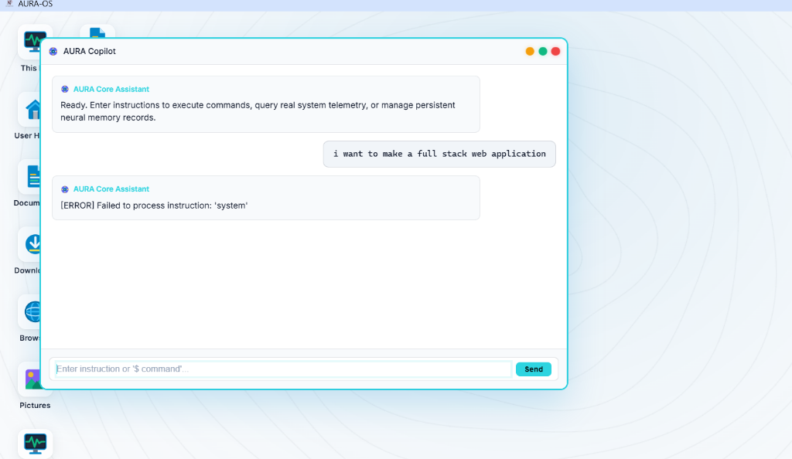
  <br/>
  <em>File Explorer: Sandboxed filesystem browser managing <code>~/Documents</code>, <code>~/Downloads</code>, file uploads/downloads, and recycle bin recovery.</em>
</p>

---

### 2.10 Multi-Stage UEFI Diagnostic Bootloader
<p align="center">
  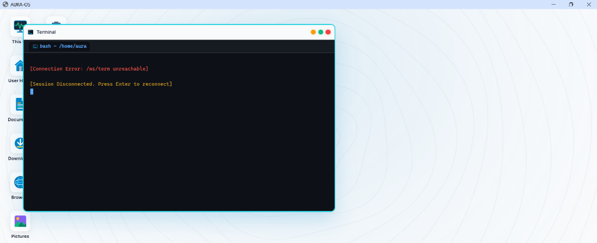
  <br/>
  <em>Boot Sequence: Multi-stage UEFI ACPI hardware probing, physical RAM allocation verification, and storage overlay mounting.</em>
</p>

---

### 2.11 System Settings & Control Panel
<p align="center">
  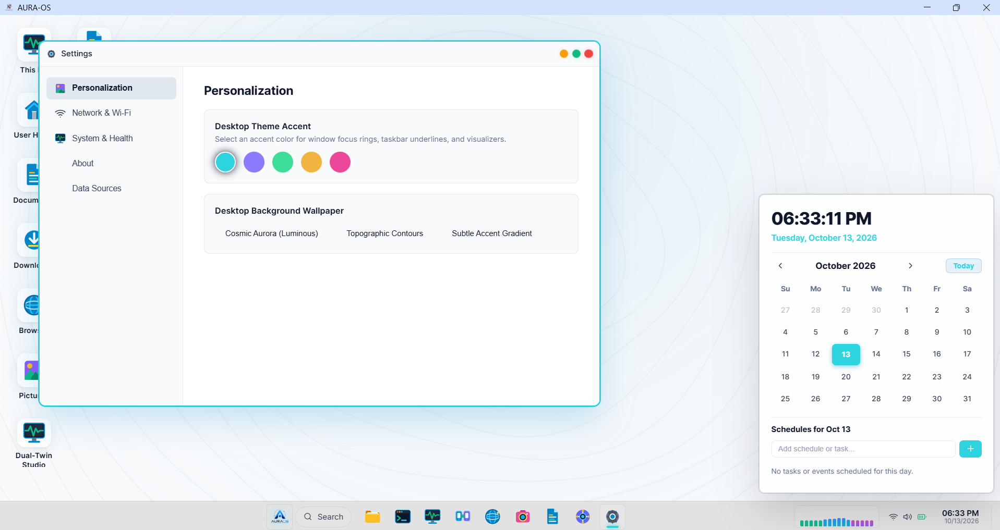
  <br/>
  <em>System Settings: Desktop personalization, high-contrast themes, wallpaper canvas engines, and network management.</em>
</p>

---

## 3. High-Level Architectural Topology

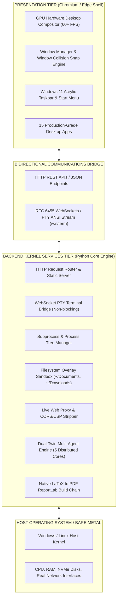

---

## 4. Dual-Twin Multi-Agent Topology (5 Distributed Cores)

AURA-OS coordinates 5 autonomous distributed agent cores arranged in a directed acyclic graph (DAG):

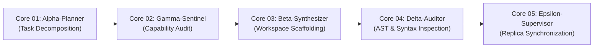

### The 5 Agent Cores Specification

| Core | Agent Name | Primary Responsibility | Execution Artifacts | Fallback Mode |
| :--- | :--- | :--- | :--- | :--- |
| **01** | **Alpha-Planner** | Ingests mission requests, plans tasks, formulates DAG dependency requirements, and classifies runtime environments (`latex-research`, `fullstack-app`, `python-datascience`). | Structured Mission Plan, DAG dependency list. | Pure LLM / Local rule-based decomposition. |
| **02** | **Gamma-Sentinel** | Audits host compilers (`pdflatex`, `gcc`, `node`, `python`) and system PATH. Determines if the local machine is 100% compatible or if a **Replica Twin** must take over. | Environmental Audit Matrix, Capability Verdict. | Autonomous Replica Twin Takeover. |
| **03** | **Beta-Synthesizer** | Scaffolds files, directories, manifests (`main.tex`, `package.json`, `main.py`) directly to `~/Documents/`. | Directory trees, starter code, templates. | Pure template synthesis via `env.py`. |
| **04** | **Delta-Auditor** | Performs static AST validation, UTF-8 encoding checks, and cyclic import detection ensuring 0 syntax errors. | Syntax pass log, 0-error integrity report. | Static syntax linting & KaTeX verification. |
| **05** | **Epsilon-Supervisor** | Maintains sub-2ms state synchronization between host and replica workspaces before launching Studio IDE. | Live sync pulse, event bus notification. | Local memory cache sync. |

---

## 5. Autonomous Self-Healing & Replica Takeover Sequence

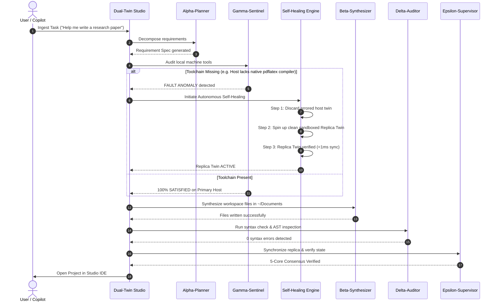

---

## 6. Applications Ecosystem

| Application | Identifier | Launch Shortcut | Key Capabilities |
| :--- | :--- | :--- | :--- |
| **Dual-Twin Studio** | `twin` | Taskbar, Start Menu | 5-Core Multi-Agent Topology, capability auditing, self-healing replica takeover, and live telemetry. |
| **AURA Copilot** | `agent` | Taskbar, Start Menu | Real-time AI agent orchestrator with sandboxed command execution and autonomous service recovery. |
| **LaTeX & Studio IDE** | `editor` | Taskbar, Start Menu | Academic paper editor, live KaTeX formula renderer, black-and-white layout, and native PDF compiler. |
| **Interactive Terminal** | `terminal` | `Ctrl+Alt+T`, Start Menu | VT100/ANSI PTY console with direct compiler access (`gcc`, `python`, `node`) and HTTP RPC fallback. |
| **Multi-Tab Web Browser**| `browser` | Taskbar, Start Menu | Full browser with history navigation and backend CORS/CSP header stripping proxy. |
| **Task Manager & Monitor** | `taskmgr` | Tray Equalizer, Start Menu | Real-time CPU, RAM, and Disk telemetry charts with process termination controls. |
| **File Explorer** | `files` | Taskbar, Start Menu | Full hierarchy file tree, drag-and-drop upload/download, and recycle bin management. |
| **System Settings** | `settings` | Start Menu | Desktop configuration: themes, custom wallpapers, and Wi-Fi management. |
| **Snipping Tool** | `snipping` | Start Menu | Screen capture utility with flash feedback and direct file saving. |
| **Media Player** | `media` | Start Menu | Audio and video player supporting HTTP 206 Partial Content range streaming. |
| **Clock & Calendar** | `calendar` | Tray Clock, Start Menu | Navigable calendar with local event schedules store. |
| **Paint Studio** | `paint` | Start Menu | HTML5 Canvas drawing tool with brushes and PNG export. |
| **Diagnostic Bootloader** | `boot` | OS Cold Start | Multi-stage UEFI ACPI and physical memory probing sequence. |

---

## 7. Quickstart & Deployment Guide

### Option 1: Native Host Launcher (Recommended)
Runs AURA-OS directly against your host's bare-metal hardware and Python runtime for butter-smooth 60+ FPS cursor fidelity and zero virtualization driver capture bottlenecks:

#### Windows
```bat
cd /d D:\AURA-OS
launch_aura_os.bat
```
*Or directly via Python:*
```powershell
python aura_core\server.py
```

#### Linux / macOS
```bash
python3 aura_core/server.py
```
Open in Chrome or Edge:
```bash
msedge --app=http://localhost:8000 --start-maximized
```

### Option 2: VirtualBox VM Deployment
```powershell
.\setup_virtualbox_vm.ps1
```

---

## 8. Clean Project Directory Structure

```
D:\AURA-OS\
├── .github/                       # GitHub Actions CI/CD & Automation Workflows
│   └── workflows/
│       └── ci.yml                 # Automated Python syntax check & release packaging
├── aura_core/                     # Backend Kernel Subsystems & Web Shell
│   ├── api/                       # REST API Services (env, fs, proc, proxy, auth)
│   │   ├── env.py                 # Multi-Agent Template & System Capability Auditor
│   │   ├── fs.py                  # Sandboxed Filesystem Operations
│   │   ├── proc.py                # Process Management & Hardware Telemetry
│   │   └── proxy.py               # Live Web Traffic Sanitization & Proxy
│   ├── ai_engine.py               # 5-Core Multi-Agent Topology & Consensus Engine
│   ├── server.py                  # Multithreaded Core HTTP/WS Server Engine
│   ├── ws.py                      # RFC 6455 WebSocket Parser & PTY Bridge
│   ├── storage_home/              # Sandboxed Userland Root (~/Documents, ~/Downloads)
│   └── ui/                        # Client Presentation Desktop Compositor
│       ├── index.html             # Shell DOM Structure & SVG Sprites
│       ├── css/                   # Design Tokens, Window Styles, Taskbar Acrylic
│       └── js/                    # Modular ES6 Compositor & 15 System Apps
│           ├── apps/
│           │   ├── twin.js        # Dual-Twin Multi-Agent Studio
│           │   ├── agent.js       # AURA Copilot
│           │   ├── editor.js      # LaTeX & Studio IDE
│           │   ├── browser.js     # Web Browser
│           │   ├── terminal.js    # VT100 Terminal
│           │   └── ...
│           └── shell/             # Desktop, Taskbar, Start Menu, Window Manager
├── docs/                          # Comprehensive Technical Documentation
│   ├── README.md                  # Documentation Directory Index
│   ├── DUAL_TWIN_ARCHITECTURE.md  # 5-Core Multi-Agent Topology & Consensus Specs
│   ├── ARCHITECTURE.md            # Detailed Subsystem & Microkernel Design
│   ├── APPLICATIONS.md            # Complete 15-App Ecosystem Matrix
│   ├── API_REFERENCE.md           # REST Endpoints & WebSocket Protocol Specs
│   ├── BENCHMARKS.md              # Performance, Memory, and Latency Comparisons
│   ├── QUICKSTART.md              # Step-by-Step Deployment Guide
│   └── screenshots/               # High-Resolution UI Captures
├── screenshots/                   # Root Visual Architecture Captures
│   ├── 01_dual_twin_studio_orchestrator.png
│   ├── 02_latex_studio_academic_editor.png
│   ├── 03_fullstack_web_app_browser.png
│   ├── 04_aura_copilot_ai_assistant.png
│   ├── 05_desktop_environment_overview.png
│   ├── 06_interactive_terminal_pty.png
│   ├── 07_task_manager_telemetry.png
│   ├── 08_file_explorer_storage.png
│   ├── 09_uefi_bootloader_sequence.png
│   └── 10_system_settings_control_panel.png
├── scripts/                       # ISO, VMDK, and Build Utilities
│   ├── build_alpine_live.py
│   ├── build_complete_iso.py
│   ├── make_bootable_iso.py
│   └── ...
├── launch_aura_os.bat             # Turnkey Single-Click Native Host Launcher
├── launch_aura_os.ps1             # PowerShell Native Host Launcher
├── setup_virtualbox_vm.ps1        # Automated VirtualBox VM Provisioning
└── AURA_OS_Logo.png               # Official High-Resolution System Identity Logo
```

---

## 9. Technical Documentation & References

- [Dual-Twin Multi-Agent Topology Specification](docs/DUAL_TWIN_ARCHITECTURE.md)
- [System Architecture Specification](docs/ARCHITECTURE.md)
- [Applications & Subsystems Matrix](docs/APPLICATIONS.md)
- [REST API & WebSocket Reference](docs/API_REFERENCE.md)
- [Performance Benchmarks & Comparisons](docs/BENCHMARKS.md)
- [Quickstart & Deployment Guide](docs/QUICKSTART.md)

---

## 10. Academic Information

- **Project**: Major Project (Mid-Semester Evaluation)
- **Author**: Nitanshu Tak (SAP ID: `500121943`)
- **Specialization**: B.Tech Computer Science & Engineering (Cloud Computing & Virtualization Technology)
- **Mentor**: Dr. Nadeem Khandey Sir (Assistant Professor, Selection Grade)
- **Institution**: School of Computer Science, University of Petroleum & Energy Studies (UPES), Dehradun
- **License**: MIT Open Source License
