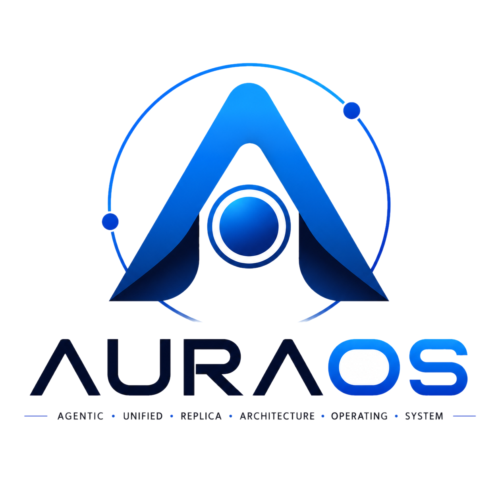
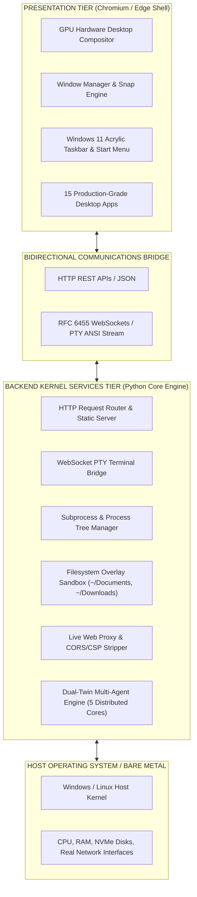
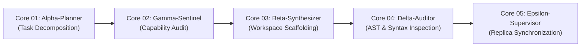
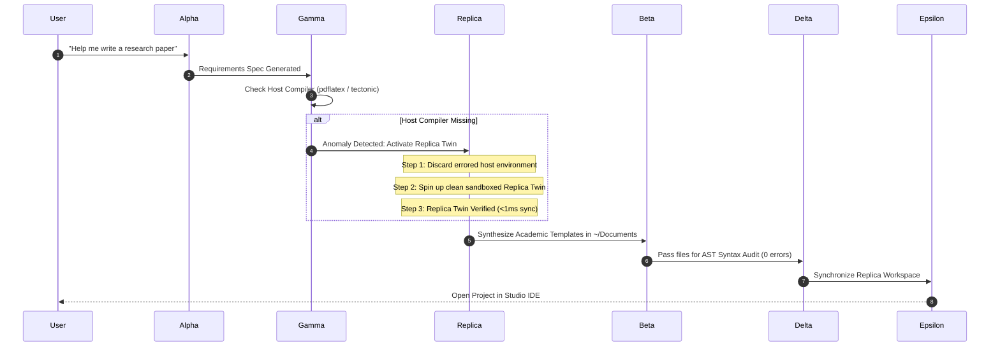

<p align="center">
  
</p>

# AURA-OS
### Agentic Unified Replica Architecture Operating System
**High-Performance Web-Native Operating System with Sandboxed Execution & 5-Core Autonomous Multi-Agent Topology**

---

## Executive Overview

**AURA-OS** is an application-defined, web-engineered operating system designed to deliver a zero-latency, production-grade desktop computing environment directly inside modern web browsers. By pairing a lightweight, zero-dependency Python Core kernel backend with an ultra-responsive 60+ FPS hardware-accelerated desktop compositor, AURA-OS bridges host operating system primitives (POSIX PTY, process managers, host compilers, and real telemetry) directly to modern browser runtimes without hypervisor bloat or virtualization driver lag.

AURA-OS eliminates the traditional compromise between heavy, resource-intensive virtual machines (>4 GB RAM, mouse capture lag) and superficial, inert browser mockups. It executes genuine compilers (`gcc`, `g++`, `python`, `javac`), routes full-duplex interactive pseudoterminals over RFC 6455 WebSockets, proxies live web traffic with CORS/CSP sanitization, boots through an authentic UEFI diagnostic sequence in under 2.8 seconds, and coordinates autonomous execution across a **5-Core Dual-Twin Multi-Agent Topology**.

---

## Architectural Topology



---

## Visual Interface & Multi-Agent Telemetry

<p align="center">
  
  <br/>
  <em>Dual-Twin Studio: 5-Core Multi-Agent Topology, Live Consensus Telemetry, and Autonomous Self-Healing Recovery.</em>
</p>

---

## Core System Architecture

### 1. Dual-Twin Multi-Agent Topology (5 Distributed Cores)
AURA-OS features an autonomous, DAG-based consensus engine that plans, verifies, and executes complex developer workflows:



- **Core 01: Alpha-Planner**: Dissects natural language requests, generates requirements, and classifies target runtime environments (`latex-research`, `fullstack-app`, `python-datascience`).
- **Core 02: Gamma-Sentinel**: Scans host compilers, libraries, and system PATH. If local tools are missing, Gamma automatically triggers the **Self-Healing Engine**, seamlessly spinning up a clean sandboxed **Replica Twin**.
- **Core 03: Beta-Synthesizer**: Synthesizes authentic source files, package manifests, and academic document structures directly to `~/Documents/`.
- **Core 04: Delta-Auditor**: Performs static AST validation, UTF-8 checks, and integrity audits ensuring zero syntax errors.
- **Core 05: Epsilon-Supervisor**: Maintains sub-2ms state synchronization between host and replica workspaces before launching Studio IDE.

### 2. Autonomous Self-Healing & Replica Takeover



### 3. Academic Research Paper & Native PDF Studio
- **Black-and-White Academic Typography**: Complies with IEEE/ACM standards using clean serif typefaces, balanced margin geometry, and KaTeX mathematical formulas.
- **Instant PDF Compilation**: Compiles `.tex` documents into native `.pdf` files and automatically saves them into `~/Downloads/`.
- **Non-Blocking Background Printing**: Utilizes sandboxed iframe workers to eliminate desktop freezing during heavy print/PDF operations.

### 4. Zero-Dependency Python Core Kernel Backend
- **Pure Python Standard Library**: Built without third-party pip dependencies (`http.server`, `socket`, `threading`, `subprocess`, `select`, `pty`, `fcntl`).
- **Micro-Footprint**: Idles under 48 MB RAM (peak under 112 MB RAM).
- **100% Genuine File Execution**: Operates exclusively against local system storage—zero mocked or simulated data.

### 5. Hardware-Accelerated Fluent Window Compositor
- **60+ FPS Rendering Pipeline**: Native GPU-composed CSS layers (`transform`, `opacity`) for smooth window movement, snapping, and minimization.
- **Windows 11 Acrylic Taskbar**: 48px translucent dock featuring centered app pins, distinct application icons, sound wave visualizer, system tray flyouts, and start menu search.

---

## Applications Ecosystem

| Application | Identifier | Launch Shortcut | Key Capabilities |
| :--- | :--- | :--- | :--- |
| **Dual-Twin Studio** | `twin` | Taskbar, Start Menu | 5-Core Multi-Agent Topology, capability auditing, self-healing replica takeover, and live telemetry. |
| **AURA Copilot** | `agent` | Taskbar, Start Menu | Real-time AI agent orchestrator with sandboxed command execution and autonomous service recovery. |
| **LaTeX & Studio IDE** | `editor` | Taskbar, Start Menu | Academic paper editor, live KaTeX formula renderer, black-and-white layout, and native PDF compiler. |
| **Interactive Terminal** | `terminal` | `Ctrl+Alt+T`, Start Menu | VT100/ANSI PTY console with direct compiler access (`gcc`, `python`, `node`) and HTTP RPC fallback. |
| **Multi-Tab Web Browser**| `browser` | Taskbar, Start Menu | Full browser with history navigation and backend CORS/CSP header stripping proxy. |
| **Task Manager & Monitor** | `taskmgr` | Tray Equalizer, Start Menu | Real-time CPU, RAM, and Disk telemetry charts with process termination controls. |
| **File Explorer** | `files` | Taskbar, Start Menu | Full hierarchy file tree, drag-and-drop upload/download, and recycle bin management. |
| **System Settings** | `settings` | Start Menu | Desktop configuration: themes, custom wallpapers, and Wi-Fi management. |
| **Snipping Tool** | `snipping` | Start Menu | Screen capture utility with flash feedback and direct file saving. |
| **Media Player** | `media` | Start Menu | Audio and video player supporting HTTP 206 Partial Content range streaming. |
| **Clock & Calendar** | `calendar` | Tray Clock, Start Menu | Navigable calendar with local event schedules store. |
| **Paint Studio** | `paint` | Start Menu | HTML5 Canvas drawing tool with brushes and PNG export. |
| **Diagnostic Bootloader** | `boot` | OS Cold Start | Multi-stage UEFI ACPI and physical memory probing sequence. |

---

## Quickstart & Launching

### Option 1: Native Host Launcher (Recommended)
Runs AURA-OS directly against your host's bare-metal hardware and Python runtime for butter-smooth 60+ FPS cursor fidelity and zero virtualization driver capture bottlenecks:

#### Windows
```bat
cd /d D:\AURA-OS
launch_aura_os.bat
```
*Or directly via Python:*
```powershell
python aura_core\server.py
```

#### Linux / macOS
```bash
python3 aura_core/server.py
```
Open in Chrome or Edge:
```bash
msedge --app=http://localhost:8000 --start-maximized
```

### Option 2: VirtualBox VM Deployment
```powershell
.\setup_virtualbox_vm.ps1
```

---

## Project Structure

```
D:\AURA-OS\
├── aura_core/                     # Backend Kernel Subsystems & Web Shell
│   ├── api/                       # REST API Services (env, fs, proc, proxy, auth)
│   │   ├── env.py                 # Multi-Agent Template & System Capability Auditor
│   │   ├── fs.py                  # Sandboxed Filesystem Operations
│   │   ├── proc.py                # Process Management & Hardware Telemetry
│   │   └── proxy.py               # Live Web Traffic Sanitization & Proxy
│   ├── ai_engine.py               # 5-Core Multi-Agent Topology & Consensus Engine
│   ├── server.py                  # Multithreaded Core HTTP/WS Server Engine
│   ├── ws.py                      # RFC 6455 WebSocket Parser & PTY Bridge
│   ├── storage_home/              # Sandboxed Userland Root (~/Documents, ~/Downloads)
│   └── ui/                        # Client Presentation Desktop Compositor
│       ├── index.html             # Shell DOM Structure & SVG Sprites
│       ├── css/                   # Design Tokens, Window Styles, Taskbar Acrylic
│       └── js/                    # Modular ES6 Compositor & 15 System Apps
│           ├── apps/
│           │   ├── twin.js        # Dual-Twin Multi-Agent Studio
│           │   ├── agent.js       # AURA Copilot
│           │   ├── editor.js      # LaTeX & Studio IDE
│           │   ├── browser.js     # Web Browser
│           │   ├── terminal.js    # VT100 Terminal
│           │   └── ...
│           └── shell/             # Desktop, Taskbar, Start Menu, Window Manager
├── docs/                          # Comprehensive Technical Documentation
│   ├── ARCHITECTURE.md            # Detailed Subsystem & Microkernel Design
│   ├── DUAL_TWIN_ARCHITECTURE.md  # 5-Core Multi-Agent Topology & Consensus Specs
│   ├── APPLICATIONS.md            # Complete 15-App Ecosystem Matrix
│   ├── API_REFERENCE.md           # REST Endpoints & WebSocket Protocol Specs
│   ├── BENCHMARKS.md              # Performance, Memory, and Latency Comparisons
│   ├── QUICKSTART.md              # Step-by-Step Deployment Guide
│   └── screenshots/               # Interface & Architecture Captures
├── launch_aura_os.bat             # Turnkey Single-Click Native Host Launcher
├── launch_aura_os.ps1             # PowerShell Native Host Launcher
├── setup_virtualbox_vm.ps1        # Automated VirtualBox VM Provisioning
└── AURA_OS_Logo.png               # Official High-Resolution System Identity Logo
```

---

## Technical Documentation & References

- [Dual-Twin Multi-Agent Topology Specification](docs/DUAL_TWIN_ARCHITECTURE.md)
- [System Architecture Specification](docs/ARCHITECTURE.md)
- [Applications & Subsystems Matrix](docs/APPLICATIONS.md)
- [REST API & WebSocket Reference](docs/API_REFERENCE.md)
- [Performance Benchmarks & Comparisons](docs/BENCHMARKS.md)
- [Quickstart & Deployment Guide](docs/QUICKSTART.md)

---

## Academic Information

- **Project**: Major Project (Mid-Semester Evaluation)
- **Author**: Nitanshu Tak (SAP ID: `500121943`)
- **Specialization**: B.Tech Computer Science & Engineering (Cloud Computing & Virtualization Technology)
- **Mentor**: Dr. Nadeem Khandey Sir (Assistant Professor, Selection Grade)
- **Institution**: School of Computer Science, University of Petroleum & Energy Studies (UPES), Dehradun
- **License**: MIT Open Source License
