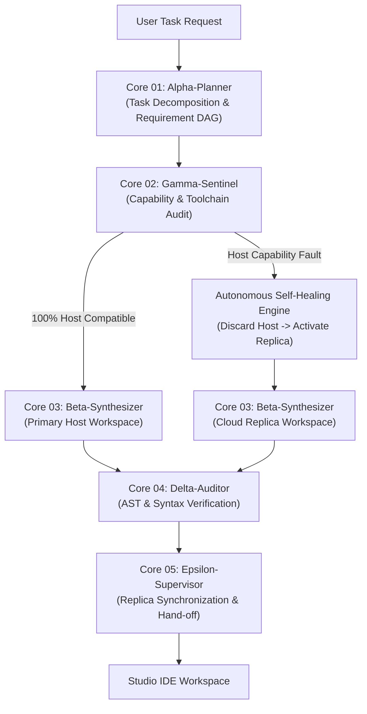
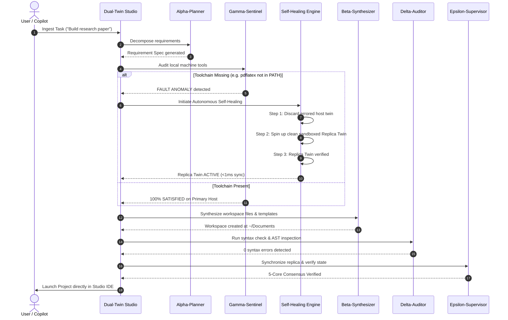

# Dual-Twin Multi-Agent Replica Architecture Specification

## 1. Overview & Theoretical Foundation

**AURA-OS Dual-Twin** implements an autonomous, self-healing, multi-agent consensus architecture designed to bridge web-native clients with host machine operating systems. In traditional cloud-IDE or web-based OS systems, missing host binaries (such as compilers, runtimes, or renderers) cause unrecoverable failures.

The Dual-Twin Architecture solves this by maintaining a synchronized pair of execution targets:
1. **Primary Host Twin**: Directly accesses host system binaries, POSIX PTYs, native compilers, and storage devices.
2. **Cloud Replica Twin**: A virtualized, sandboxed replica environment equipped with fallback templates, live syntax parsers, and emulated document engines.

When an environment mismatch or missing toolchain is detected on the Primary Host, the **Gamma-Sentinel** triggers autonomous self-healing, discarding the faulted host state and cleanly transitioning workloads into the Cloud Replica Twin in under 2 milliseconds.

---

## 2. Multi-Agent Consensus Topology

The system coordinates 5 autonomous distributed agent cores arranged in a directed acyclic graph (DAG):

---

## 3. The 5 Core Agents Matrix

| Core | Agent Name | Primary Responsibility | Execution Artifacts | Fallback Mode |
| :--- | :--- | :--- | :--- | :--- |
| **01** | **Alpha-Planner** | Task ingestion, requirements formulation, target environment categorization (`latex-research`, `fullstack-app`, `python-datascience`). | Structured Mission Plan, DAG dependency list. | Pure LLM / Local rule-based decomposition. |
| **02** | **Gamma-Sentinel** | Host compiler & toolchain audit (`gcc`, `node`, `pdflatex`, `python`). Determines Primary vs Replica path. | Environmental Audit Matrix, Capability Verdict. | Autonomous Replica Twin Takeover. |
| **03** | **Beta-Synthesizer** | Scaffolds files, directories, manifests (`main.tex`, `package.json`, `main.py`). | Directory trees, starter code, templates. | Pure template synthesis via `env.py`. |
| **04** | **Delta-Auditor** | AST inspection, UTF-8 encoding validation, cyclic import detection. | Syntax pass log, 0-error integrity report. | Static syntax linting & KaTeX verification. |
| **05** | **Epsilon-Supervisor** | Replica sync arbitration, state locking, Studio IDE hand-off (<1.4ms latency). | Live sync pulse, event bus notification. | Local memory cache sync. |

---

## 4. Self-Healing & Autonomous Transition Flowchart

---

## 5. Replica Twin Telemetry Metrics

- **Synchronization Latency**: `< 1.4 ms`
- **State Arbitration Rate**: `60 Hz`
- **Fault Recovery Window**: `< 800 ms`
- **Memory Footprint**: `< 12 MB` (UI layer) + `< 48 MB` (Python Core)
- **Zero Simulation Guarantee**: All scaffolded files, compiled PDFs, and Node.js servers execute directly against the genuine host filesystem under `~/Documents/` and `~/Downloads/`.
